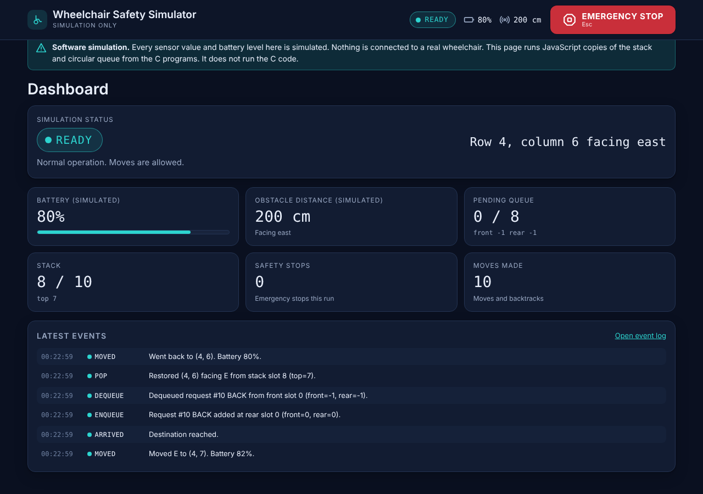
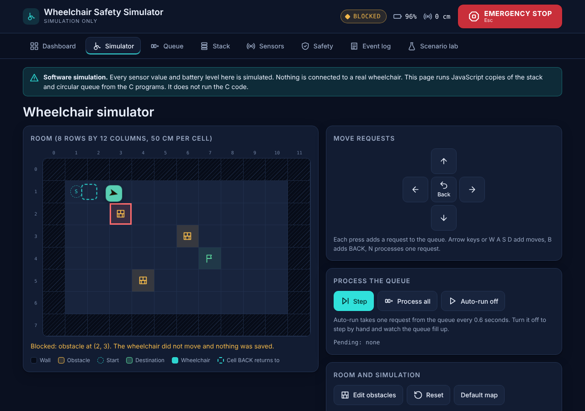
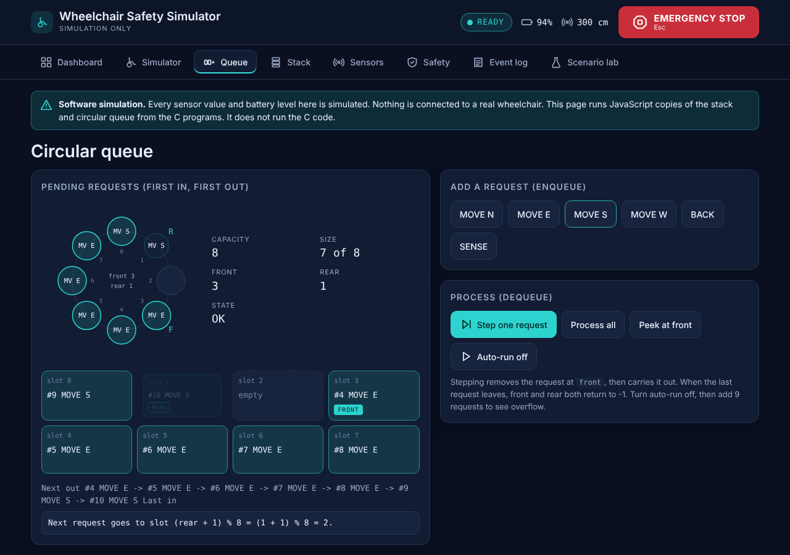
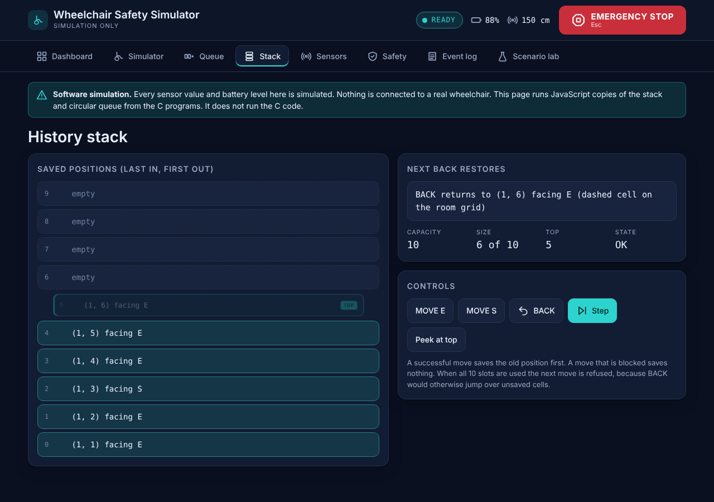
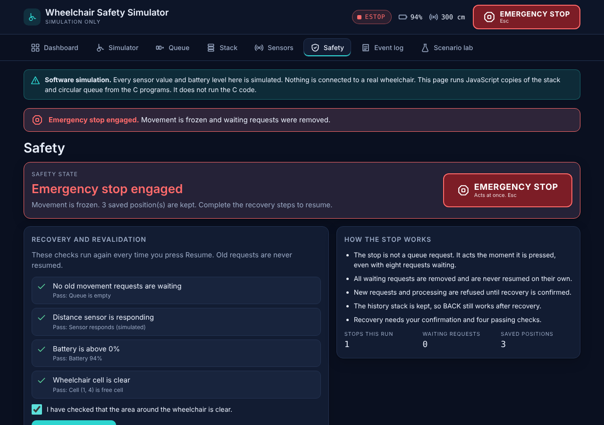
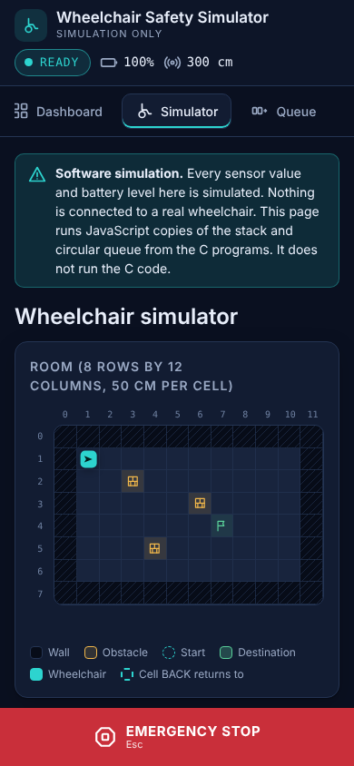

# Smart Assistive Wheelchair Control and Safety Simulator

A college project for **CSS2281 (C Programming and Data Structures Lab)**. It shows two data structures, an **array stack** and a **circular queue**, doing a real job inside a small wheelchair safety simulation. It comes in two forms: three C console programs, and a website you open in a browser.

**In one sentence:** movement requests wait in a circular queue and are carried out in order, every position the wheelchair leaves is saved on a stack so that BACK can retrace the path, and simple if/else safety rules (walls, obstacles, emergency stop) decide whether each move is allowed.

> **What this is not.** Everything here is a **software simulation**. No real sensor, motor, camera, ESP32 or wheelchair is connected, and there is **no AI**. The website runs its own JavaScript version of the algorithms. It does **not** run the C code. This is an educational model, not a safety-certified controller.

## Contents

1. [See it](#1-see-it)
2. [What is used](#2-what-is-used)
3. [How it works](#3-how-it-works)
4. [The two data structures](#4-the-two-data-structures)
5. [Safety rules](#5-safety-rules)
6. [The C programs and the website](#6-the-c-programs-and-the-website)
7. [Folder structure](#7-folder-structure)
8. [How to run it](#8-how-to-run-it)
9. [Tests](#9-tests)
10. [Viva, demonstration and test report](#10-viva-demonstration-and-test-report)
11. [Limitations](#11-limitations)
12. [Glossary](#12-glossary)

## 1. See it

| | |
|---|---|
|  |  |
| **Dashboard.** Status, battery, queue and stack sizes, latest events. | **Obstacle.** The move into the obstacle is refused and nothing is saved. |
|  |  |
| **Circular queue.** `rear` has wrapped round to the start of the array. | **Stack.** Saved positions, newest on top, and where BACK will return. |
|  |  |
| **Emergency stop.** Recovery needs a confirmation and four passing checks. | **Phone layout.** The stop button stays at the bottom. |

## 2. What is used

| What | Where | Why |
|---|---|---|
| **C (C99)**, compiled with `gcc` or `clang` | `c-programs/` | The data structures and the simulation as console programs. Only `stdio.h`, no other library. |
| **HTML, CSS and plain JavaScript** | `web/` | The website. No framework, no build step, no database, no paid service, no server. |
| **Arrays and index variables** | both | The stack and the queue are fixed-size arrays. No linked list and no library container. |
| **Python 3, Node.js, Playwright (Chromium)** | `c-programs/tests/`, `web/tests/` | Testing only. You do not need them to run the C programs or the website. |
| **Google Fonts** | `web/index.html` | Optional. Used when you are online. Offline, the page uses your system fonts. |

## 3. How it works

The wheelchair lives on an **8 by 12 grid** (each cell is 50 cm). It starts at row 1, column 1, facing east. The border is wall, and three cells hold obstacles. The destination is row 4, column 7.

**The idea in one minute**

1. You press a direction. That does **not** move the chair. It adds a **request** at the rear of the **circular queue** (capacity 8).
2. **Processing** takes the oldest request from the front of the queue (first in, first out).
3. Safety rules are checked **at that moment**. If the move is allowed, the chair's **old position is pushed on the stack** (capacity 10) and the chair moves one cell.
4. If the move is refused (wall, obstacle, emergency stop and so on) nothing is pushed and the chair stays where it is.
5. **BACK** pops the stack and puts the chair back on the most recent saved position (last in, first out).
6. **Emergency stop** does not wait in the queue. It acts at once, removes every waiting request, keeps the stack, and refuses new requests until the operator recovers.

```
   you press a direction            safety rules              the chair
  ┌────────────────────┐   ┌────────────────────────┐   ┌──────────────────┐
  │  ENQUEUE request   │ → │ DEQUEUE oldest request │ → │ push old position │ → moves one cell
  │  (rear of queue)   │   │ is the next cell free? │   │ on the STACK      │
  └────────────────────┘   └───────────┬────────────┘   └──────────────────┘
                                       │ refused: nothing is pushed
        BACK = pop the stack ──────────┘ emergency stop = empties the queue at once
```

**A worked example** (real output of `wheelchair-simulator`, the bracketed line is what it prints after each action)

| You do | What happens | Queue (front, rear) | Stack top |
|---|---|---|---|
| Add MOVE E, MOVE E, MOVE S | three requests wait | `front=0 rear=2` | `-1` (empty) |
| Process | chair moves (1, 1) to (1, 2); (1, 1) is saved | `front=1 rear=2` | `0` |
| Process | chair moves to (1, 3); (1, 2) is saved | `front=2 rear=2` | `1` |
| Process | south of (1, 3) is the obstacle. **BLOCKED**, chair stays, nothing saved | `front=-1 rear=-1` (empty) | `1` |
| Add BACK, process | chair returns to (1, 2), the top entry is removed | `front=-1 rear=-1` | `0` |

## 4. The two data structures

Both are fixed-size arrays with index variables. The C programs and the JavaScript use **exactly the same conventions**.

### Stack (history of previous positions): last in, first out

`top` is the index of the newest item. `top = -1` means empty.

```
push(p):  if top == SIZE - 1  -> overflow, stop        pop():   if top == -1 -> underflow, stop
          top = top + 1                                         p = stack[top]
          stack[top] = p                                        top = top - 1
                                                                return p
```

The old position is pushed **just before** a successful move. A blocked move is refused before the push, so it never enters the history. If the stack is full the move is refused too, because moving without saving would make BACK jump over cells that were never saved.

### Circular queue (pending requests): first in, first out

`front` is the oldest request (next to leave), `rear` the newest. `%` makes the index wrap from the last slot to slot 0, so space freed at the front is reused without shifting anything.

```
enqueue(x): if (rear + 1) % MAX == front -> full, stop       dequeue():  if front == -1 -> empty, stop
            if front == -1 { front = 0; rear = 0 }                       x = queue[front]
            else           rear = (rear + 1) % MAX                       if front == rear { front = -1; rear = -1 }
            queue[rear] = x                                              else             front = (front + 1) % MAX
                                                                         return x
```

Size is not stored: it is `(rear - front + MAX) % MAX + 1`, or 0 when `front == -1`.

**Wraparound example** with MAX 5:

| Operation | front | rear | Slots 0 1 2 3 4 |
|---|---|---|---|
| start | -1 | -1 | . . . . . |
| enqueue N, E, S, W, N | 0 | 4 | N E S W N (full) |
| enqueue one more | 0 | 4 | refused: (4 + 1) % 5 = 0 = front |
| dequeue, dequeue | 2 | 4 | . . S W N |
| enqueue E | 2 | 0 | E . S W N (rear wrapped from 4 to 0) |
| enqueue S | 2 | 1 | E S S W N (full again) |

### Sizes used and cost

| | Stack | Queue |
|---|---|---|
| Stack and queue demonstration programs | `SIZE 5` | `MAX 5` |
| Simulator (C and website) | `STACKSIZE 10` (`STACKCAP` in JavaScript) | `QSIZE 8` (`QCAP` in JavaScript) |
| Empty | `top == -1` | `front == -1` |
| Full | `top == SIZE - 1` | `(rear + 1) % MAX == front` |
| Overflow and underflow | message printed, nothing changes | message printed, nothing changes |

Push, pop, peek, enqueue, dequeue and the empty and full checks are all **O(1)**. Showing every item is O(n). Memory is fixed: one array each.

## 5. Safety rules

**A move is checked in this order:** emergency stop engaged, battery empty (website only), sensor failed (website only), then "is the next cell free?" (inside the room and not a wall or obstacle). The first rule that says no wins.

| Mode | Meaning |
|---|---|
| READY | Normal operation, moves are allowed |
| BLOCKED | The last move was refused by a wall, obstacle or the edge |
| ARRIVED | The chair is on the destination |
| FAULT | The sensor has failed, moves are refused (website) |
| ESTOP | Emergency stop engaged |
| DEPLETED | Battery is empty (website) |

**Emergency stop.** Sets mode ESTOP, empties the queue, keeps the stack, and refuses new requests and processing. Old requests are never resumed on their own after a stop.

**Recovery.** In the C simulator you type `1` to confirm. On the website you tick a confirmation box and four checks must pass: no old requests waiting, the distance sensor responding, battery above 0%, and the chair's cell clear.

**Revalidation.** A queued move is checked against the room when it runs, not when it was added. An obstacle placed in between still blocks it.

**Simulated sensor.** It counts free cells ahead of the chair, up to 6 cells, so at most 300 cm. A simulated sensor failure gives "No reading" and the chair stops (a fail-safe choice). The battery drops 2% per move and a low-battery warning appears below 20%.

## 6. The C programs and the website

They are **two separate implementations of the same rules.** There is no bridge between them.

| | C programs (`c-programs/`) | Website (`web/`) |
|---|---|---|
| Stack and circular queue | Yes, same conventions | Yes, same conventions |
| Grid, obstacles, walls, BACK | Yes | Yes |
| Sensor distance, emergency stop and release | Yes | Yes |
| Battery, sensor failure, obstacle editing | No | Yes |
| Four-point recovery checklist | No (type `1` to confirm) | Yes |
| Six ready-made scenarios, event log view | No | Yes |
| Interface | Text menu | Dashboard, grid, queue ring, stack, live log |

**How we know they agree:** `web/tests/parity.py` gives the same commands to the compiled C simulator and to the JavaScript simulation, and compares front, rear, top, position, heading and mode after every command. Result: 65 states compared, 0 differences. The sensor-failure scenario is not part of this, because the C program has no sensor failure.

## 7. Folder structure

```
wheelchair-sim/
├── README.md                          this file
├── index.html                         forwards to web/index.html so GitHub Pages can publish the website
├── run-all-tests.sh                   runs every test and updates the results in docs/test-report.md
├── c-programs/
│   ├── wheelchair-history-stack.c     array stack of positions: push, pop, peek, display (SIZE 5)
│   ├── request-circular-queue.c       circular queue of N, E, S, W requests (MAX 5)
│   ├── wheelchair-simulator.c         the project: grid, request queue, history stack, safety, emergency stop
│   ├── sample-output.txt              real terminal sessions of the three programs
│   └── tests/c-program-tests.py       35 scripted tests that type into the programs
├── web/
│   ├── index.html                     the page: 8 views and the icons
│   ├── css/styles.css                 colours, layout, dark and light theme, phone layout
│   ├── js/config.js                   every constant: sizes, battery cost, the default map
│   ├── js/structures.js               Stack and CircularQueue (no page code)
│   ├── js/safety.js                   simulated sensor, mode rules, recovery checks
│   ├── js/simulation.js               grid, chair, queue and stack use, event log, command language
│   ├── js/scenarios.js                the six ready-made scenarios
│   ├── js/ui.js                       drawing and input only; never edits the state directly
│   └── tests/                         unit-tests.js, browser-tests.js, parity.py, mutation-check.sh
└── docs/
    ├── viva-and-demo.md               simple viva answers and a rehearsed 4-minute demonstration
    ├── test-report.md                 test results, checklist of what is verified, limitations, defects found
    └── screenshots/                   the six pictures above
```

On the website, `ui.js` never changes the state. It calls methods on the simulation object and redraws from it, so every number on screen is read from the real queue and stack. The eight views are Dashboard, Simulator, Queue, Stack, Sensors, Safety, Event log and Scenario lab.

## 8. How to run it

**C programs** (any C compiler. On Windows use MSYS2/MinGW, or paste the file into CodeTantra):

```
cd c-programs
gcc -Wall -Wextra -std=c99 -o wheelchair-simulator wheelchair-simulator.c
./wheelchair-simulator                 (Windows: .\wheelchair-simulator.exe)
```

The other two programs compile the same way: `wheelchair-history-stack.c` and `request-circular-queue.c`. Directions are typed as capital letters N, E, S, W. Menu option numbers are printed on screen.

**Website:** double-click `web/index.html`. Nothing to install and no internet needed. It needs a recent browser (it was tested in Chromium, which Chrome and Edge use). If your browser blocks something when opened as a file, run `python3 -m http.server 8000` inside `web/` and open http://localhost:8000.

**Website online (GitHub Pages):** in the repository on github.com open **Settings, Pages**, choose branch **main** and folder **/ (root)**, and save. After a minute or two GitHub shows a link such as `https://YOUR-USERNAME.github.io/wheelchair-safety-simulator/`. This publishes the website only; the C programs cannot run there.

**Tests:** see the next section.

## 9. Tests

Run everything from the project folder (needs gcc, Python 3 and Node.js; the browser tests also need `npm install playwright` then `npx playwright install chromium`; on Windows use Git Bash or WSL):

```
sh run-all-tests.sh
```

Or one at a time:

```
python3 c-programs/tests/c-program-tests.py       35 tests that type into the three C programs
node web/tests/unit-tests.js                       76 logic tests, including 8000 random actions
python3 web/tests/parity.py                        C simulator and JavaScript compared command by command
sh web/tests/mutation-check.sh                     breaks the code 13 ways and checks the tests notice
node web/tests/browser-tests.js                    58 end-to-end checks, a 112-check audit of every button, a demo rehearsal
```

Results of the last run (details in [docs/test-report.md](docs/test-report.md)):

| Check | Result |
|---|---|
| C programs, 0 compiler warnings under gcc and clang | 35 of 35 passed |
| Website logic | 76 of 76 passed |
| C and JavaScript agree | 65 states compared, 0 differences |
| Code deliberately broken 13 ways | all 13 caught by the tests |
| Browser end-to-end (real clicks and keys, Chromium) | 58 of 58 passed |
| Audit: every button on every view, phone and desktop width, screen and log checked after each click | 112 of 112 passed |
| Demonstration rehearsal | 23 of 23 passed |

Only Chromium was tested. Firefox, Safari, real phones, screen readers and your own computer were **not** tested. The report lists these under "needs manual verification".

## 10. Viva, demonstration and test report

- [docs/viva-and-demo.md](docs/viva-and-demo.md): simple answers on LIFO, FIFO, push, pop, enqueue, dequeue, circular queues, overflow, underflow and time complexity, and a 4-minute demonstration with exact keys and real output.
- [docs/test-report.md](docs/test-report.md): what each test covers, the checklist of what is verified, what needs manual verification and the known limitations.

## 11. Limitations

- It is a simulation. It must not be used to control a real wheelchair.
- The C programs and the website are separate implementations, compared by tests but not connected.
- Battery, sensor failure, obstacle editing, the recovery checklist and the scenarios exist only on the website.
- In the C programs directions must be capital letters.
- Nothing is saved: reloading the page starts again.
- On a 390 px phone the room cells are about 25 px wide, so placing obstacles by touch is fiddly.
- The page needs a browser from 2023 or later.

## 12. Glossary

| Word | Meaning |
|---|---|
| **Stack** | A pile where you add and remove at the top only. Last in, first out (LIFO). |
| **Queue** | A line where you add at the back and remove from the front. First in, first out (FIFO). |
| **Circular queue** | A queue in an array where the index wraps from the last slot to slot 0, so freed slots are reused. |
| **Push, pop** | Add to the top of a stack, remove from the top of a stack. |
| **Enqueue, dequeue** | Add at the rear of a queue, remove from the front of a queue. |
| **Overflow** | Adding to a structure that is full. The program refuses and changes nothing. |
| **Underflow** | Removing from a structure that is empty. The program refuses and changes nothing. |
| **front, rear, top** | Index variables: the oldest queue item, the newest queue item, the newest stack item. |
| **O(1)** | Takes the same time however many items there are. |
| **Emergency stop** | A command that acts at once, outside the queue, and freezes the chair until the operator recovers. |
| **Parity test** | A test that gives the same input to the C program and to the JavaScript and compares their results. |
| **Mutation check** | A test of the tests: the code is broken on purpose and the tests must fail. |
